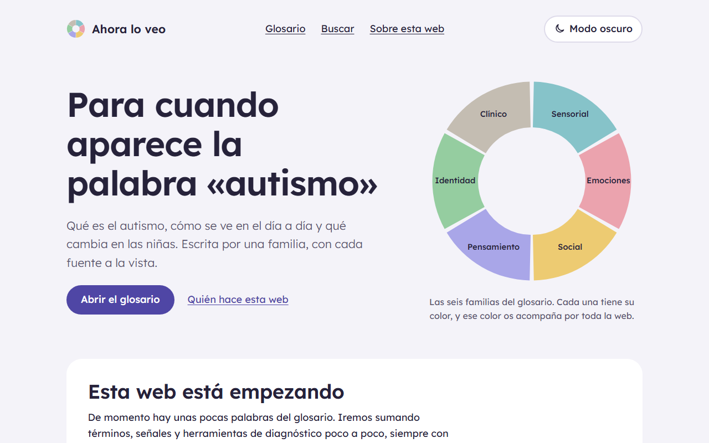

# Ahora lo veo

> Para cuando aparece la palabra «autismo».

Web de información sobre autismo para quien empieza, con el foco en cómo se presenta en mujeres y niñas. Toda afirmación lleva su fuente y cada página su fecha de revisión.

## Qué hay

- Glosario con fichas validadas: cada término necesita al menos una fuente y su fecha de revisión, o la compilación falla.
- Modo claro y oscuro, y funciona sin JavaScript.
- Pensada para cumplir WCAG 2.2 AA: axe revisa cada página, en modo claro y oscuro, en cada cambio.
- Búsqueda en el navegador con Pagefind, sin servidor.

El diseño completo está en [docs/plans/2026-10-30-ahoraloveo-design.md](docs/plans/2026-10-30-ahoraloveo-design.md).

## Desarrollo

Necesita Node 22.23 o posterior.

| Comando | Qué hace |
|---|---|
| `npm run dev` | Servidor de desarrollo (sin búsqueda) |
| `npm test` | Pruebas unitarias |
| `npm run build` | Comprueba tipos, compila y crea el índice de búsqueda |
| `npm run preview` | Sirve la web compilada |
| `npm run test:e2e` | Accesibilidad, reflujo, teclado, tema, búsqueda y CSP sobre la web compilada (antes, `npm run build`) |
| `npm run enlaces` | Busca enlaces internos rotos en la web compilada |

Las cabeceras de seguridad (`public/_headers`) solo las aplica Cloudflare. Para probarlas en local, arranca `npx wrangler dev --port 8788` y ejecuta `BASE_URL=http://localhost:8788 npm run test:e2e`.

## Contenido

Las fichas son ficheros YAML en `src/content/`. Los esquemas están en `src/lib/esquemas.ts`.

## Publicación

Cada push a `main` pasa las pruebas en GitHub Actions y, si salen bien, publica en Cloudflare Workers la misma web que se ha probado.

## Licencias

- Código: [MIT](LICENSE).
- Textos: [CC BY-SA 4.0](LICENCIA-TEXTOS.md).
- Tipografía Lexend: SIL Open Font License.
